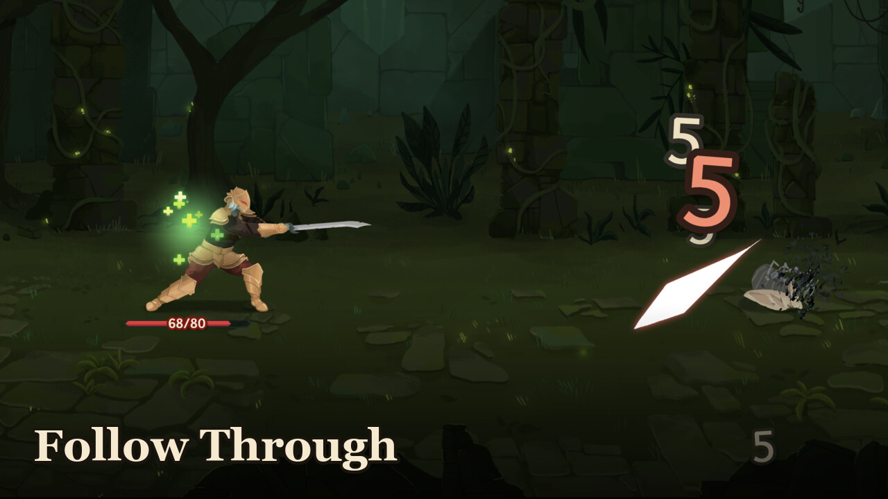

# Follow Through

A Slay the Spire 2 mod. When a multi-hit attack kills the last enemy partway through, the rest of the hits
still play out on the corpse, for show:

- your character swings for every remaining hit, as the real attack would
- the attack's hit effect lands where the enemy fell
- the impact sound plays (the enemy's own impact sound if the attack has none)
- a floating damage number per hit shows what it would have dealt, overkill included

The victory/rewards screen waits until the show is over. Every hit plays at the attack's natural rhythm.

## Skipping

Short replays just play. Once a replay has run for 2 seconds (`skip_after_seconds`) with more than about
0.75 s left, a small **Click to skip** fades in at the bottom of the screen. Any mouse click, key or controller
button then ends the replay and opens the rewards. That click is used up by the skip, so it can't click
anything on the rewards screen behind it. Clicks before the hint appears are not intercepted.

## Purely cosmetic, co-op safe

Follow Through only draws and plays sounds. It deals no damage, fires no game triggers (relics, powers,
"on attack" effects), uses none of the game's random numbers and creates no game actions. The combat has
already ended in the game's own simulation when the replay starts. The only thing it delays is your own
rewards screen, which the game opens locally on each player's machine. In co-op every player who has the
mod sees the replay on their own screen. Players without it see the normal ending, and runs never desync.
The manifest declares `affects_gameplay: false`.

## Settings

`STS2_FollowThrough.conf` sits next to the mod's DLL and is created on first launch:

| key | default | meaning |
| --- | --- | --- |
| `enabled` | `true` | turn the mod off without uninstalling |
| `max_replay_seconds` | `0` | 0 = no limit; above 0, long chains speed up to fit in that many seconds |
| `show_skip_hint` | `true` | show the "Click to skip" hint (skipping still works without it) |
| `skip_after_seconds` | `2.0` | how long a replay runs before it can be skipped |
| `fallback_hit_sfx` | `true` | play the enemy's impact sound when the attack has no hit sound |
| `default_hit_gap_sec` | `0.3` | spacing between hits when the attack's real rhythm couldn't be measured |
| `debug` | `false` | log each replay decision to the game log (`[FollowThrough] ...`) |

## Known limits

- Only attacks whose hits stop because every target died are replayed. Attacks cut short for other reasons
  (the attacker dying, the enemy reviving) are left alone.
- If the killing hit was the first, the spacing between hits uses `default_hit_gap_sec`, since there was no
  real rhythm to measure.
- The replay targets the enemies hit by the last real hit. Random-target attacks replay on that enemy.
- Built and tested against game version v0.107.1. Members of the game are looked up by name at startup.
  After a game update or on the public beta branch, if anything it needs is missing, the mod logs one line
  and turns itself off instead of misbehaving.

## Install

- **Steam Workshop:** subscribe, enable it in **Settings > Mods**, restart the game.
- **Manual:** put `STS2_FollowThrough.dll` and `STS2_FollowThrough.json` (the `mod_manifest.json`, renamed) in
  the game's `mods/` folder: `SlayTheSpire2.app/Contents/MacOS/mods/` on macOS, `<game dir>/mods/` on
  Windows/Linux. Restart the game.

Building from source and the test approach: see [CONTRIBUTING.md](CONTRIBUTING.md).

## License

MIT, see [LICENSE](LICENSE). Slay the Spire 2 is (c) Mega Crit; this mod bundles none of its files.
